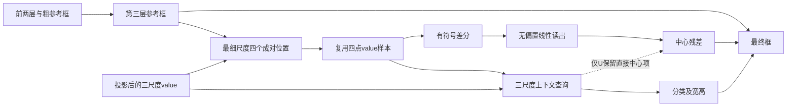

# 基于局部成对差分的RT-DETRv2末层中心残差约束研究

中文论文工作稿，2026-10-24建立，2026-10-25补充直接先例与复现入口。本文准备方法、理论边界与实验设置；**H2正式结果、摘要和结论尚未填写，本文不是已完成论文或投稿就绪声明**。研究实现绑定[PR21运行版本e50bedb](https://github.com/Six-of-Sheep/SparseRTDETR_VisDrone/tree/e50bedbe8e41bdfd3c47d09f7076d9644e438e26)，本文独立于实验分支，不改变正在执行的合同。

阅读顺序：正文 → [创新边界](NOVELTY_BOUNDARY.md) → [终态判读](RESULT_INTERPRETATION.md) → [条件验证方案](CONDITIONAL_VALIDATION.md)；[复现入口](REPRODUCIBILITY.md)提供成员恢复及版本说明，[原来源索引](SOURCE_INDEX.json)和[本次准备索引](PREPARATION_INDEX.json)记录证据范围。本轮读取本地材料并进行限定公开资料核查，没有连接服务器或新增模型执行。本稿的待填状态不能作为实时训练状态。

## 摘要

待固定终点评价、成本和中心记录闭合后撰写。摘要需要同时交代研究问题、具体约束、D−U与D−N的结果、代价及数据限制；不提前写入改善、显著性或原创性结论。

## 1 引言

航拍小目标检测同时依赖目标周围的语义信息和有限的局部空间变化。对于迭代细化边界框的检测器，前面的解码层已经形成粗位置，最后一层仍需要决定如何调整中心及尺寸。上下文能够帮助识别和估计目标，但它是否应当以独立的输出项直接参与最后的中心平移，仍可作为一个具体、可否定的问题检验。

本研究沿用共同协议适配的RT-DETRv2-R18，而非原封不动的作者训练配置。已有工作提供了数据、评价、重复执行和成本控制基础。其中，整图加四切片方案C在既有三个seed中取得了可重复的精度提升，但需要额外推理计算；这些结果属于多视图工程方案，不能充当本文中心约束的效果证据。原A/B/C结果继续作为独立历史成果保存，参见[已冻结成果](../../research/abc_results_20261019/README.md)。

上一轮采样宽高下限方案P未通过冻结的质量门槛。其局部支持诊断观察到部分采样变化，却没有证明目标内支持增加能够解释检测收益，也没有确定上下文干扰是训练退化的根因。因此，本文不把P的失败当作H2必然成立的前提，而转向一个受控假设：**在前两层提供粗框之后，限制末层中心残差只能由局部成对差分产生，能否比允许直接上下文中心项的控制更有利于小目标精定位？**

为检验这一假设，本文在第三解码层的最细特征尺度复用四个采样值，以已有的成对差分构造无偏置中心残差。分类与宽高继续使用上下文查询。对照U使用同样的采样、差分读出和监督，但保留原上下文中心输出；候选D删除该直接项。D−U因而是本轮关键比较，D−历史N则用于判断相对既有单整图基线的实用取舍。

本文拟检验的贡献限定于末层中心残差的结构约束及其证据。成对差分不是新算子，受限函数类也不具有更强的表达能力。是否存在有用的归纳偏置，必须由固定实验回答；是否构成区别于直接先例的论文增量，还需结合结果和文献边界判断。

## 2 相关工作及本文边界

RT-DETRv2提供了本文采用的检测器基础[1]。任务解耦、差分特征以及方向性定位均已有研究。2026-10-25限定核查新增CF-DETR和BorderDet方法正文，既有五篇沿用原审读记录；VarifocalNet仅核官方摘要及返回片段，未完整审读。作者代码未复现，表中比较是方法路径比较，不是同协议性能比较。

|表1：直接先例|已经涉及的操作或问题|本次检验的差异|
|---|---|---|
|SD-DETR[2]|分类与定位使用分开的查询、交叉注意力及FFN|不增加两套解码分支；只删除第三层直接上下文中心项，粗框和宽高/分类路径仍依赖上下文|
|CDC[3]、PiDiNet[4]|邻域或像素对差分、共有分量抵消、可折叠的线性读出|差分操作本身沿用已有思想；检验将它作为末层中心残差唯一直接输入的约束|
|PiDiViT[5]|在检测中融合差分与普通特征，结合多尺度ROI信息|U保留融合式自由度，D排除直接上下文中心项；U不是PiDiViT的完整复现|
|SABL[6]|利用轴向特征、分桶与精细回归进行边界定位|仍采用中心/宽高表示，不引入四边分桶标签或重新评分|
|CF-DETR（AAAI 2022）[8]|全局上下文粗定位，框引导ROI局部细化；细层预测框，分类沿用粗层|粗到细与局部细化思路已有先例；本次仅检验第三层中心残差排除直接上下文项的限制|
|BorderDet[9]|沿预测框边界采样/池化，与原点特征融合后细化框和分类|框相对局部信息不新；已读方法没有H2的反对称差分中心约束|

这些差异说明实验比较什么，不证明全领域不存在等价方法。本文不使用“首次提出差分”“首次解耦分类与定位”或“恢复小目标原生细节”等表述。

VarifocalNet的官方摘要也已包含星形框特征和框细化[10]，因此固定形状采样加轻量细化不能单独承担创新主张。D−U只检验直接中心项的删除，不能单独证明反对称性优于任意自由四点读出，或排除所有容量和优化作用。详细阅读范围与未读部分见[创新边界核查](NOVELTY_BOUNDARY.md)。

## 3 方法

### 3.1 模型与符号

模型使用300个普通查询、3个解码层、8个注意力头、256维表示和步长为8、16、32的三个特征尺度。每头每尺度4个采样点，共12点。输入为单张768×1344整图。本文仅修改第三解码层最细特征尺度及中心输出路径；前两层和第三层其余两个尺度沿用原生计算。

令第三层输入参考框为归一化画布坐标下的 \(r=(c_x,c_y,w,h)\)，其中 \(c=(c_x,c_y)\)。\(V_0\) 表示最细尺度经过value投影后的特征场，\(q_3\) 表示第三层上下文查询。下标0表示特征尺度，不能与解码层编号混用。

### 3.2 共享采样与差分

U与D在最细尺度使用四个固定的框相对位置：

\[
s_{x+}=c+(w/4,0),\quad s_{x-}=c-(w/4,0),\qquad
s_{y+}=c+(0,h/4),\quad s_{y-}=c-(0,h/4). \tag{1}
\]

四点在8个头上的几何位置相同，每头读取自身32个value通道。双线性插值使用原实现的零填充与`align_corners=False`约定；拼接各头通道后，每个样本 \(v_i\in\mathbb R^{256}\)。四点不增加输入分辨率、采样点或推理视图，也不包含P的单特征单元下限。

样本同时参与原12点的注意力加权求和和以下无权差分读出，仅采样一次：

\[
d_x=\tfrac12(v_{x+}-v_{x-}),\qquad
d_y=\tfrac12(v_{y+}-v_{y-}),\qquad d=[d_x;d_y]. \tag{2}
\]

第三层其余两个尺度各4点保留学习offset，12点联合softmax机制不变。因此“局部”指已有最细特征场的框相对变化，不代表新增或恢复了原图中丢失的细节。

### 3.3 中心残差约束与最小控制

三臂中心logit残差分别为

\[
\delta_c^{N}=f_c(q_3^N),\qquad
\delta_c^{U}=W_Dd^U+f_c(q_3^U),\qquad
\delta_c^{D}=W_Dd^D,\quad W_D\in\mathbb R^{2\times512}. \tag{3}
\]

\(W_D\) 无偏置、零初始化；U与D各自学习该参数。上标表示各模型自身的特征和查询，不能假定独立训练后的U/D中间量相同。N的最细尺度也使用原学习offset，与U/D不同。

最终框与分类输出写为

\[
\hat c=\sigma\bigl(\iota(c)+\delta_c\bigr),\qquad
\hat{(w,h)}=\sigma\bigl(\iota(w,h)+f_{wh}(q_3)\bigr),\qquad
\hat p=f_{cls}(q_3). \tag{4}
\]

\(\iota\) 是原生`inverse_sigmoid`，使用 \(\epsilon=10^{-5}\) 的数值截断。D删除原第三层box头最终线性层的两个中心输出行，保留宽高输出和共享隐藏层。分类与宽高保留上下文计算路径，但改变采样和训练会改变 \(q_3\)，不能据此声称它们的数值保持不变。



图1为计算关系示意，不是实测注意力或目标示例。D不包含虚线所示路径，但仍通过参考框、特征及前两层依赖上下文。

### 3.4 梯度、监督与实现边界

采样坐标使用原生detach后的参考框，不新增穿过前一框的采样坐标梯度。训练返回的最终框与辅助框仍保留原实现中未detach前一参考框的作用；采样参考和输出参考不能被同一个detach变量替代。因此，这一设计不等于将中心梯度与前层完全隔离。

普通query与DN query使用同一计算规则，沿用原Hungarian匹配、VFL、L1、GIoU、辅助监督和DN处理。没有新损失、边缘伪标签或教师。推理不读取GT、真值目标大小或目标内支持率。下列伪代码描述第三层，不替换生产实现：

```text
输入：查询、三尺度value、采样参考r_detach、原输出参考r_output
1. 最细层按式(1)取四点；其余尺度保留原offset。
2. 一次插值得到全部样本；复用最细四点计算式(2)。
3. 原12点注意力和解码操作产生q3。
4. U：center_delta = detail + native_center(q3)。
   D：center_delta = detail。
5. 宽高与分类使用原头；按原训练/推理参考路径组成输出。
```

实测模型参数量为N 20,094,584、U 20,079,160、D 20,078,646。U/D删除最细层学习offset的16,448个参数，并增加1,024个差分读出参数；D再删除514个直接中心输出参数。U/D公共参数初值一致，不能称严格等参数模型。

### 3.5 可证明的局部性质与反例

**约束线性读出。** 对固定样本，令 \(W_D=[W_x,W_y]\)，有

\[
\delta_c^D=\tfrac12W_xv_{x+}-\tfrac12W_xv_{x-}
             +\tfrac12W_yv_{y+}-\tfrac12W_yv_{y-}. \tag{5}
\]

每对系数反对称且和为零。该表达可折叠为普通四点线性读出，不产生额外信息。U将直接中心输出行置零即可表示D；D是更受限的函数类。可能的收益来自限制是否有用，不来自更强的可表达性，也不保证训练轨迹等价。

**共模抵消的条件。** 在固定采样位置，对有效投影value添加空间常量向量 \(k\)。令一对采样有效插值权重和为 \(\alpha_+,\alpha_-\)，则

\[
\Delta d_x=\tfrac12(\alpha_+-\alpha_-)k. \tag{6}
\]

仅当有效支持权重和相同时保证抵消，完整内区是充分条件。零填充、mask或边界不对称会破坏它。这一性质不能扩大为对背景、语义或图像光照变化不敏感，因为网络特征中的变化未必是常量。

**局部方向响应。** 若采样区域支持完整，投影场恰为 \(V_0(x,y)=a x+b y+k\)，其中坐标与式(1)一致，则

\[
d_x=a w/4,\qquad d_y=b h/4. \tag{7}
\]

差分编码局部方向变化，但背景斜坡同样满足式(7)，非零差分不证明目标存在或修正方向正确。极小参考框的响应也可趋弱，方法没有实际采样跨度或细节强度下界。

**零差分边界。** 当 \(d_x=d_y=0\) 时，D的学习中心残差为零，最终中心为 \(\sigma(\iota(c))\)。只有在原数值截断范围内才能解释为保持粗中心；不能声称边界处处严格零位移。平坦特征与错误粗框同时出现时，D无法依靠这条末层残差纠偏，而U仍可能利用上下文直接项。上述反例是设计风险，不应在结果不利时删除。

## 4 实验设置

### 4.1 数据及评价适用范围

研究沿用公开VisDrone2019-DET的既有固定成员：官方train的6,471张中，项目此前划出1,602张，剩余4,869张为train_core；548张官方val作为development。本轮只使用train_core训练与548张终点评价，不访问1,602张集合。成员来源、形成规则及既有缺证在[前稿数据说明](https://github.com/Six-of-Sheep/SparseRTDETR_VisDrone/blob/ccfb03578d21d950ee41fe0746f001aa80483c15/docs/papers/r18_sampling_scale/MANUSCRIPT_v0.1.md)留存。

本分支已提供train_core与development的可逆成员TSV及标准库恢复工具，能够逐字节恢复原manifest，见[复现说明](REPRODUCIBILITY.md)。它补齐成员获取方式，不替代原始数据或改变数据关联限制。

train_core与development精确图像SHA交集为零，但共有24个来自文件名的序列键；该键不是完整飞行或地点标识。近重复和场景关联未完全排除，548张也已被反复用于开发。因此，本轮定位为单seed development筛选，不宣称未见、序列独立或无泄漏验证。历史1,602张集合的独立资格仍为BLOCKED，不能通过重新命名改变。

### 4.2 三臂角色与训练

|表2：臂|最细层采样与中心项|本轮角色|
|---|---|---|
|N|原学习offset；原上下文中心项|复用已认证历史B0固定e120 EMA及两档评分，不重新训练|
|U|固定四点；差分项加原中心项|本轮新训的最小否定控制|
|D|与U相同四点；仅差分中心项|本轮唯一H2候选|

U/D从共同ImageNet骨干与seed0公共初态独立开始，各训练120轮、36,480次更新；每轮304次更新，物理batch8、累积2。采用768×1344、BF16前向与FP32损失，原AdamW、学习率 \(10^{-4}\)、2,000次warmup及余弦降至 \(10^{-6}\)、梯度裁剪0.1和第118轮起弱增强日程。优化器、EMA和RNG独立建立，不使用旧e120或短验收state续训。原匹配与损失系数不变。

N复用输出经过认证，但原训练STOP和缺CLOSED事实保留。其身份是`AUTHENTICATED_OUTPUT_NOT_ORIGINAL_STAGE_CLOSURE`。D−N带历史训练比较限制；同会话测速不能消除该限制。D−U是检验直接中心通路约束的主要控制，但它仍包含删除该项所伴随的514参数差异及训练轨迹差异。

### 4.3 固定终点及成本

只使用固定e120 EMA，不选择最佳中间轮。U/D各对548张进行FP32、batch4的单整图推理；N引用原认证评分。主top600、次top300分别使用原主评价器和COCO bridge，不混合预算，不合并不同集合AP。延续预算后raw-ignore过滤、不补位，不新增NMS或阈值。原主评价器是固定官方规则的CPU实现，本项目未执行官方MATLAB运行时。

同会话N/U/D使用相同64张图，FP32、batch4，每模型2遍暖机与6遍实测。六轮模型顺序覆盖全部排列，使每模型在每个位置恰好出现两次。保留18次实测、均值、样本SD及allocated/reserved峰值。端到端时间包括解码、resize、H2D、forward、排序、ignore和同步，排除模型载入与GT解析；不能当作batch1实时FPS。D/N时间和allocated比均须不超过1.05。

完整质量门槛照录于[终态判读表](RESULT_INTERPRETATION.md)，来自运行配置，不能根据结果改写。门槛是工程研究筛选目标，不是显著性水平或期刊录用标准。

### 4.4 中心证据的定义

在U/D既有终点forward中，记录第二层粗参考中心与第三层最终中心，不增加诊断forward。各模型用自身最终300个普通query、原Hungarian和训练有效GT配对，再按原图面积 \(0<a\le1024\) 选择小目标。每一配对的误差定义为

\[
e_{\mathrm{coarse}}=\frac{\|c_{\mathrm{coarse}}-c^*\|_2}{\sqrt a},\qquad
e_{\mathrm{final}}=\frac{\|c_{\mathrm{final}}-c^*\|_2}{\sqrt a},\qquad
\Delta e=e_{\mathrm{final}}-e_{\mathrm{coarse}}. \tag{8}
\]

中心先转回原图像素坐标。报告粗/最终均值、中位数、\(\Delta e\) 正零负计数和实际配对数，无置信筛选。该统计说明“本模型最终所选配对上粗到细如何变化”；它不是独立粗框匹配评价，也不是AP的同一总体。U/D可能匹配不同query和GT，跨臂均值之差不能直接写成同一对象的配对因果效应。N缺粗中心记录保持UNKNOWN，不补548张推理。

## 5 结果与讨论（待终态）

|表3：本轮结果槽位|N|U|D|填表依据|
|---|---|---|---|---|
|top600、top300完整检测指标|待引用认证JSON|待终态|待终态|六份绑定评分；COCO与原主评价器分表|
|D−N、D−U、U−N|待终态|待终态|待终态|原未舍入差值及固定比较回执|
|22项质量条件及成本|待终态|待终态|待终态|原比较输出，不按显示舍入值重新裁决|
|同会话时间与显存|待终态|待终态|待终态|18次实测及原成本摘要|
|粗/最终中心误差|UNKNOWN：原N无记录|待终态|待终态|固定终点中心摘要和分母|

讨论应依次回答：D是否通过原质量及成本条件；它是否优于最小控制U；中心统计是否与预期解释一致；哪些正负指标与历史比较、样本选择或数据关联限制有关。若质量未通过，应保留负结果并结束固定配方，不能用某一个改善指标替代全部门槛。

## 6 结论（待终态）

待实际结果填写。现阶段已明确可实现的方法约束及可否定控制，尚没有本轮检测收益、跨seed重复性、机制因果或原创性成立的结论。即使单seed通过，后续验证范围仍需根据缺证另行决策，不由本文自动安排新训练。

## 参考来源

[1] RT-DETRv2: Improved Baseline with Bag-of-Freebies for Real-Time Detection Transformer. [arXiv:2407.17140v1](https://arxiv.org/abs/2407.17140v1)。采用前稿既有审读与配置核对记录。

[2] Decoupled DETR: Spatially Disentangling Localization and Classification for Improved End-to-End Object Detection. ICCV 2023. [原文](https://openaccess.thecvf.com/content/ICCV2023/papers/Zhang_Decoupled_DETR_Spatially_Disentangling_Localization_and_Classification_for_Improved_End-to-End_ICCV_2023_paper.pdf)。既有核对范围：PDF3–4页，§3.1–3.2、图3、式3。

[3] Searching Central Difference Convolutional Networks for Face Anti-Spoofing. CVPR 2020. [原文](https://openaccess.thecvf.com/content_CVPR_2020/papers/Yu_Searching_Central_Difference_Convolutional_Networks_for_Face_Anti-Spoofing_CVPR_2020_paper.pdf)。既有核对范围：PDF3–4页，§3.1、式2–4。

[4] Pixel Difference Networks for Efficient Edge Detection. ICCV 2021. [原文](https://openaccess.thecvf.com/content/ICCV2021/papers/Su_Pixel_Difference_Networks_for_Efficient_Edge_Detection_ICCV_2021_paper.pdf)。既有核对范围：PDF3–4页，§3、式2–3。

[5] When Pixel Difference Patterns Meet ViT: PiDiViT for Few-Shot Object Detection. ICCV 2025. [原文](https://openaccess.thecvf.com/content/ICCV2025/papers/Zhou_When_Pixel_Difference_Patterns_Meet_ViT_PiDiViT_for_Few-Shot_Object_ICCV_2025_paper.pdf)。既有核对范围：PDF3–5页，§3.1–3.3、式1–7。

[6] Side-Aware Boundary Localization for More Precise Object Detection. ECCV 2020. [原文](https://www.ecva.net/papers/eccv_2020/papers_ECCV/papers/123490392.pdf)。既有核对范围：PDF4–5页，图2、§3.1–3.2。

[7] Detection and Tracking Meet Drones Challenge. IEEE TPAMI, 2022, 44(11): 7380–7399. [DOI](https://doi.org/10.1109/TPAMI.2021.3119563)。采用前稿已核题录；完整成员与评价实现仍以项目协议为准。

[8] CF-DETR: Coarse-to-Fine Transformers for End-to-End Object Detection. AAAI 2022, 185–193. [官方题录](https://ojs.aaai.org/index.php/AAAI/article/view/19893)、[正文](https://cdn.aaai.org/ojs/19893/19893-13-23906-1-2-20220628.pdf)。本轮重点核对PDF3–5页、图2/4、式1–3及迭代预测段。

[9] BorderDet: Border Feature for Dense Object Detection. ECCV 2020. [正文](https://www.ecva.net/papers/eccv_2020/papers_ECCV/papers/123460528.pdf)。本轮重点核对PDF5–8页§3.2–3.4、图3、式1–2和相关消融。

[10] VarifocalNet: An IoU-aware Dense Object Detector. CVPR 2021. [官方题录与摘要](https://openaccess.thecvf.com/content/CVPR2021/html/Zhang_VarifocalNet_An_IoU-Aware_Dense_Object_Detector_CVPR_2021_paper.html)。本轮PDF访问受限，只有摘要及检索片段，不作全文审读声明。

## 附录：复现身份与文稿状态

科学实现、配置、正式链说明及审查记录通过[SOURCE_INDEX.json](SOURCE_INDEX.json)绑定到不可变commit和当前本地SHA。历史设计文件中“未接线”“GPU未授权”等语句描述早期阶段；当前实际生命周期以正式执行文档和带时刻交接为准，不能只照抄早期计划状态。

已有CPU和短GPU检查支持接线、BF16和保存恢复的工程一致性，不是检测收益证据。本文不复制checkpoint、数据、预测或PDF，不修改PR21，不建立本机持续观察。只读同行审查已针对共模条件、上下文依赖、参数差异、历史N和中心匹配选择五项边界复核。
