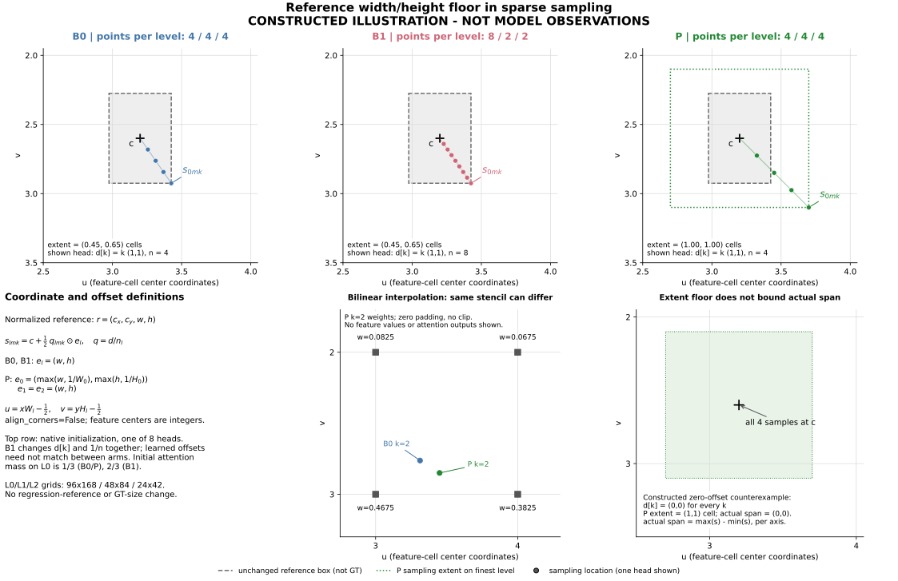
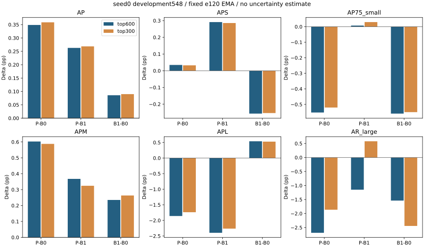
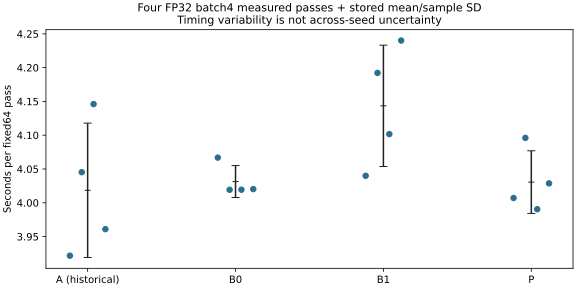
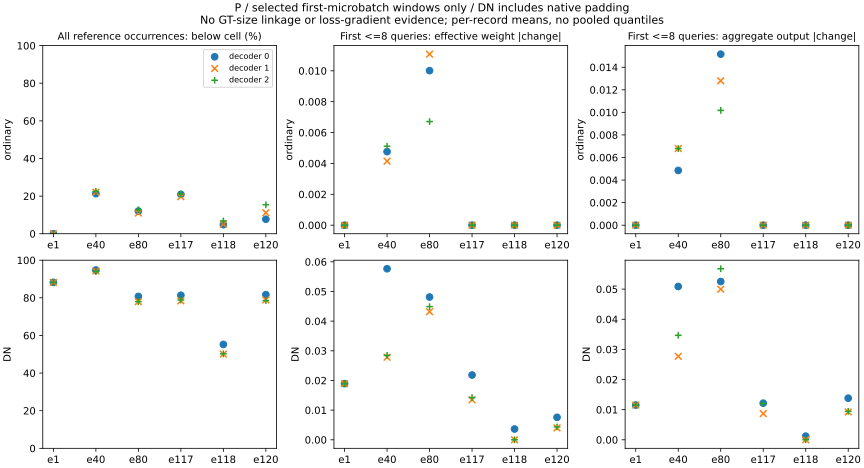

# 面向小目标检测的RT-DETRv2采样尺度约束研究

**工作标题｜中文正文 v0.1（终态结果修订）｜2026年10月23日**

本版补入已核验固定终态、全部指标/门槛及已有机制记录。工程闭合与成本通过，科学质量不通过；固定P按原门槛结束。

## 摘要

本文研究在单整图推理、总采样点数及参数量一致的条件下，对RT-DETRv2-R18最细层采样参考宽高施加一个特征单元下限的效果。采用共同ImageNet初态和完整120轮日程，比较原生4/4/4基线B0、原生8/2/2控制B1及约束候选P，在548图development上评价固定e120 EMA。主top600中，P相对B0/B1的AP分别增加0.3486/0.2629 pp，但AP75-small分别变化−0.5522/+0.0070 pp，均未达到预设收益；大目标保护亦失败。固定64图成本比为0.99979、峰值allocated比为1.00000，满足原成本条件。已有固定窗口显示部分普通查询和DN的有效插值与局部输出发生变化，但不能与检测收益或训练根因混同。结果不支持本固定配方的高IoU实用预期，亦不建立独立方法创新；单seed、开发集使用及有限机制抽样等限制完整保留。

## 1 引言

航拍图像中的目标往往占据较少像素，并同时受到密集分布、尺度差异和复杂背景的影响。对于小目标，检测框的轻微平移或尺寸误差就可能改变其在较高交并比（intersection over union，IoU）阈值下的匹配结果。例如，对两个大小相同的8像素正方形框，仅沿水平方向平移1像素，IoU即为7/9；平移2像素时降为3/5。这一几何关系说明，小目标检测既需要发现目标，也需要准确定位其边界，但它不能说明某个现有检测器的误差具体发生在哪个环节。因此，研究小目标检测时，有必要将较高IoU下的定位表现与总体精度、其他尺度目标的表现一并考察。

基于Transformer的端到端检测器通过查询与图像特征交互生成目标集合。Deformable DETR利用稀疏的多尺度采样降低全局特征交互的计算需求[1]，RT-DETRv2进一步提供按特征尺度分配采样点数的方式[2]。在四维参考框参与的采样分支中，学习得到的偏移量与参考框宽高共同决定采样位置。这使采样几何成为一个具体的研究切入点：在偏移量相同的条件下，较小的参考宽高会压缩采样位置相对参考中心的位移。然而，偏移量本身可以学习增大或缩小，参考框也会逐层更新，因而不能仅凭该公式认定检测器存在采样范围不足，更不能直接认定其发生了采样塌缩。

本项目此前在共同训练协议下比较过单整图基线A与整图加四个局部视图的参照方案C。已有结果提示，在增加视图计算的条件下，小目标高IoU指标存在改善空间，同时也出现了大目标召回方面的取舍。这些历史结果提供了研究动机，但多视图同时改变了目标在输入中的呈现尺度、上下文和候选竞争关系，不能据此把收益归因于单一的采样机制。本文保留A和C作为历史背景，将研究条件收窄到单整图推理，采用同轮重新训练的基线开展比较。

本文关注的问题是：**在保持总采样点数和可训练参数量一致的条件下，对最细特征层采样所用的参考宽高施加一个特征单元的下限，能否改善小目标高IoU检测，并控制中大目标退化及推理成本？** 待检验的假设是，当参考宽高小于最细层的一个特征单元时，限制其用于采样的尺度可能改变有效插值权重和局部特征聚合，从而为定位提供不同的信息。与这一预期相对应的反向可能也同样存在：约束可能主要作用于去噪查询，可能引入更多背景信息，也可能被学习的偏移量补偿，最终不产生所需的检测收益。

为检验上述问题，本文设置原始采样分配基线B0、原生细层点数分配控制B1和参考宽高约束候选P。三者使用相同的总采样点数、参数量、数据与完整训练日程；B0与P从完全一致的模型初态开始，B1仅保留原生点数分配所要求的初始化差异。评价固定在训练终点，联合考察小目标高IoU精度、中大目标保护和同轮实测成本。本文的研究范围是这一固定设计的可行性与收益边界；已有文献和算子实现已包含框引导注意力、采样尺度分配及单特征单元下限，本文不将这些一般思想列为已经成立的方法贡献。

## 2 相关工作

### 2.1 框引导的注意力与稀疏采样

Deformable DETR通过少量参考位置附近的采样点聚合多尺度特征，并结合迭代框更新进行检测[1]。在其四维参考框分支中，参考中心提供采样锚点，参考宽高调制偏移量的空间尺度。本文沿用这一框引导稀疏采样框架及双线性插值方式，研究对象并非是否应当使用参考框，而是对已有采样尺度加入局部下限后的行为。

DAB-DETR将动态锚框作为查询的显式位置表示，并利用框的宽高调制注意力的空间先验[3]。其主模型通过宽高对dense positional attention进行调制，附录中的DAB-Deformable-DETR则将动态锚框查询与稀疏可变形注意力结合。因此，不能把DAB的全部设计概括为仅适用于密集注意力。DAB所研究的动态查询表示与宽高调制表明，框几何参与特征交互已有明确先例；本文不改变查询的位置编码或原有回归参考框，只改变传给最细层采样分支的宽高。

Box-DETR进一步针对不同注意力头构造box agent，使条件空间查询能够利用框内部的不同位置[4]。它与本文都涉及框几何对特征交互的影响，但作用环节不同：box agent改变按头组织的空间查询参考位置，本文保留参考中心与查询表示，在已有稀疏采样公式中调整过小的采样参考宽高。本文没有复现Box-DETR的完整结构，也不以本实验推断相对该方法的性能优势。

### 2.2 采样点分配与采样范围

RT-DETRv2允许为不同特征层分配不同数量的采样点[2]。增加细层点数，是检验小目标检测收益是否仅来自常规细层计算分配的直接控制。因此，本文采用其原生8/2/2分配作为B1，而非另外设计一个采样网络。B1与均匀4/4/4分配的总点数一致，但点数变化同时涉及偏移量的原生初始化、按层点数归一化，以及联合softmax下初始注意力权重在尺度间的分配。这些差异在实验设置中明确保留。

Focal DETR研究不同采样范围与形状，利用平行采样分支等设计构建目标相关的特征交互[5]。其结果和消融表明，采样范围、形状与目标尺度之间需要具体分析，不能概括为范围越大越好。本文没有引入额外采样分支、目标感知矩阵或新增采样点，而是在固定点数下，仅对最细层使用的参考宽高设置下限。Focal DETR的模式尺度也不能直接等同于本文按实际特征图尺寸定义的一个特征单元。

### 2.3 特征单元尺度的下限约束

单特征单元的宽高下限并非新的数学操作。torchvision v0.19.1的RoIAlign旧坐标分支在`aligned=False`时，将特征坐标下的ROI宽高分别限制为不小于1；`aligned=True`分支不执行该限制[6]。该实现证明，按特征单元限制极小区域的采样尺度已有直接算子先例，但它不能作为本文候选检测收益的证据，也不应被扩写为所有RoIAlign实现均具有相同下限。

RoIAlign以ROI起点和规则分箱组织采样，本文则保持参考中心，利用学习的偏移量进行稀疏采样，并且仅在最细特征层施加约束。本文可明确区分的操作是“最细层采样参考宽高的逐轴单元尺度下限”，而非一般的框引导注意力或宽高裁限。当前直接先例核对未建立这一具体适配的原创性，本文据此将其作为一个受控的采样几何假设进行实验。

## 3 方法

### 3.1 模型与坐标定义

研究载体为采用共同协议的RT-DETRv2-R18。模型使用300个普通查询、3个解码器层和8个注意力头，多尺度特征的步长分别为8、16和32。设第$l$个特征层的尺寸为$H_l\times W_l$，其中$l=0$表示最细特征层。固定输入画布为768×1344时，三个特征层的尺寸分别为96×168、48×84和24×42。下文的“层”在涉及$l$时均指特征尺度；三个解码器层用$t$区分。

对第$t$个解码器层中的查询$q$，记原生四维参考框为

$$
\mathbf r_q^{(t)}=
\big(c_{x,q}^{(t)},c_{y,q}^{(t)},w_q^{(t)},h_q^{(t)}\big),
\qquad
\mathbf c_q^{(t)}=\big(c_{x,q}^{(t)},c_{y,q}^{(t)}\big).
\tag{1}
$$

参考坐标相对当前输入画布归一化；$w_q^{(t)},h_q^{(t)}>0$。它是模型内部的参考表示，不是直接从真实标注尺寸读取的框。设$\Delta\mathbf p_{qmlk}^{(t)}$为第$m$个头在特征层$l$上的第$k$个二维偏移量，$n_l$为该特征层每个头的采样点数。普通查询和训练时的去噪（denoising，DN）查询均采用同一采样几何规则。

### 3.2 原生采样与常规分配控制

在四维参考框分支中，原生采样位置写为

$$
\mathbf s_{qmlk}^{(t)}
=\mathbf c_q^{(t)}+
\frac{1}{2}\frac{\Delta\mathbf p_{qmlk}^{(t)}}{n_l}
\odot\big(w_q^{(t)},h_q^{(t)}\big),
\tag{2}
$$

其中$\odot$表示逐元素乘法。B0采用$(n_0,n_1,n_2)=(4,4,4)$，B1采用原生$(8,2,2)$。两种分配在每个注意力头、每个解码器层中均包含12个采样点。各头对采样特征进行加权聚合，其核心形式可记为

$$
\mathbf z_q^{(t)}=
\sum_{m=1}^{8}\mathbf W_m^{(t)}
\left[\sum_{l=0}^{2}\sum_{k=1}^{n_l}
a_{qmlk}^{(t)}\,\widetilde{\mathbf V}_{lm}^{(t)}
\big(\mathbf s_{qmlk}^{(t)}\big)\right],
\qquad
\sum_{l,k}a_{qmlk}^{(t)}=1.
\tag{3}
$$

式（3）只表示采样与加权聚合的核心运算，原有投影、残差连接和其余解码结构保持原生设计。注意力权重的softmax覆盖同一头的全部12个采样点，而非分别在三个特征层内归一化。因此，在均匀权重初始化下，最细层的权重总量在B0中为1/3，在B1中为2/3。B1是原生尺度分配控制，不能描述为仅增加点密度且所有其他初始化均不变。

### 3.3 最细层采样参考宽高约束

候选P保持4/4/4点数分配。定义仅用于计算采样位置的宽高向量$\mathbf e_{ql}^{(t)}$：

$$
\mathbf e_{ql}^{(t)}=
\begin{cases}
\left(\max\left(w_q^{(t)},\frac{1}{W_0}\right),
      \max\left(h_q^{(t)},\frac{1}{H_0}\right)\right), & l=0,\\
\big(w_q^{(t)},h_q^{(t)}\big), & l\in\{1,2\}.
\end{cases}
\tag{4}
$$

相应的采样位置为

$$
\mathbf s_{qmlk}^{(t)}
=\mathbf c_q^{(t)}+
\frac{1}{2}\frac{\Delta\mathbf p_{qmlk}^{(t)}}{n_l}
\odot\mathbf e_{ql}^{(t)}.
\tag{5}
$$

下限由实际最细特征图的宽高确定。$1/W_0$和$1/H_0$分别对应归一化画布中的一个最细特征单元，而不是一个原始图像像素，也不是按真实目标大小设定的阈值。本文固定采用一个单元，不搜索下限系数。该操作在全部三个解码器层的交叉注意力中应用，但每层仅修改最细特征尺度对应的4个采样点。

P不回写原参考框，不改变参考中心、框回归输出或查询位置编码，并沿用原有参考分离和辅助监督路径。实现按原生采样点顺序展开用于采样的参考表示，再对最细尺度对应位置的宽高取逐轴最大值。若某个查询的参考宽高均不小于最细层的一个单元，则该查询的采样位置计算与B0一致。但是，真实中大目标也可能对应偏小或细长的预测参考框，因而不能由GT尺寸直接推断它们一定不受约束影响。中大目标保护仍须通过终点评价检验。

下面给出单个解码器层的简化伪代码，省略批次与注意力头广播：

```text
输入：原参考框 r=(cx,cy,w,h)，偏移 Δp，特征尺寸 {(Hl,Wl)}
点数：n=(4,4,4)
对所有普通查询与训练时DN查询：
    对 l=0,1,2：
        e=(w,h)
        若 l=0：e=(max(w,1/W0), max(h,1/H0))
        对 k=1,...,nl：
            s[l,k]=(cx,cy)+0.5*(Δp[l,k]/nl)⊙e
    以原注意力权重聚合原双线性采样特征
输出：采样聚合结果；原参考框r不被该操作修改
```

P没有增加可训练参数、特征层、查询、输入视图或采样点，但新增了宽高比较与参考展开等操作。相同参数量和点数不等于相同实际耗时，相关成本由第4节的同轮测量判断。

### 3.4 双线性插值与实际采样跨度

对归一化采样位置$\mathbf s=(s_x,s_y)$，采用`align_corners=False`时，其连续特征坐标为

$$
u=W_l s_x-\frac{1}{2},\qquad
v=H_l s_y-\frac{1}{2}.
\tag{6}
$$

整数$(u,v)$对应特征单元中心。令$i=\lfloor u\rfloor$、$j=\lfloor v\rfloor$，$\alpha=u-i$、$\beta=v-j$。四个相邻单元的插值权重分别为$(1-\alpha)(1-\beta)$、$\alpha(1-\beta)$、$(1-\alpha)\beta$和$\alpha\beta$。采样坐标不作裁剪，超出特征边界的邻点沿用零填充。式（6）表达实数坐标关系，具体低精度计算仍遵循原实现的运算次序。

参考宽高下限只限制式（5）中的乘法尺度，并不直接限制采样点之间的距离。固定查询、头和特征层，横向实际跨度为

$$
S_{qml,x}^{(t)}
=W_l\left(\max_k s_{qmlk,x}^{(t)}-\min_k s_{qmlk,x}^{(t)}\right)
=\frac{W_l e_{ql,x}^{(t)}}{2n_l}
\left(\max_k\Delta p_{qmlk,x}^{(t)}-
      \min_k\Delta p_{qmlk,x}^{(t)}\right).
\tag{7}
$$

纵向同理。当所有偏移量相等或均为零时，即使参考宽高已经达到一个特征单元，实际跨度仍可为零。因此，本文使用“采样参考宽高下限”，不将其表述为实际采样跨度的硬下限。此外，两个位置即使落在同一组四邻点内，其插值权重也可能不同，不能仅凭邻点索引相同判定采样结果等价。



**图1 B0、B1与P的采样几何示意。** 图中位置为人为构造，并非模型观测。上排在最细特征网格的局部区域展示原生初始化下的一个注意力头；B1改变原生径向偏移初始化及点数归一化，P仅扩大不足一个单元的采样参考宽高。下排分别说明坐标关系、同邻点下不同的插值权重，以及零偏移时实际跨度仍为零的反例。三臂训练后学习到的偏移与权重不要求相同。

## 4 实验设置

### 4.1 数据范围与共同协议

本研究使用VisDrone2019-DET的既有项目划分。VisDrone由无人机在多种城市与郊区场景采集，用于图像检测、视频检测及跟踪等任务[9]；本研究仅使用图像目标检测部分。已有来源清单对应官方train的6471张和val的548张图像。development保留全部548张val图像；train_core为既有V2分组规划从train移出1602张后形成的4869张补集，覆盖原有10个目标类别。本文直接沿用这些固定成员，不重新划分，也不将4869张子集称为作者的完整官方训练配方。

既有V2规划先按文件名七位前缀定义的序列键与相同图像SHA联接样本，构造不可拆分组；从身份闭合、非异常且不与development共享序列键的组中构造被移出集合的候选。候选组按固定种子与盐值形成的哈希顺序排列，规划检查各前缀的组隔离、内容隔离及分布约束，再从可行前缀中选择张数最接近目标的一个。原目标数为647张，约束要求被移出集合与剩余train_core之间的各类别占比及COCO-small目标占比差异分别不超过5个百分点；实际冻结结果为57组、1602张，其补集即train_core。目标数与实际成员数不能互换。具体哈希规则、成员清单与复现入口列于附录A。

这些记录可以说明划分的形成规则，但尚不能完整说明当时为何采用上述目标数与容差，也不能证明其选择先于全部历史开发决策。规划曾利用训练标注统计进行分布约束，不能将其叙述为完全不查看标注的划分。当前train_core与development的精确图像SHA交集为0，但仍共享24个序列键；序列键只来源于文件名，并不等同于完整飞行或地点信息。因此，本文不把两者称为序列完全独立，也未排除感知近重复及同飞行、同地点关联。

548张development已经被多轮研究使用，只支持开发集合内的比较。原1602张集合的历史使用情况仍未完全核实，本研究不使用其内容进行训练、评价或配置选择。数据入口沿用原始标注、类别映射、目标有效性与忽略规则，三臂使用相同训练成员、图像顺序及增强输入，不另加目标尺寸过滤。训练中的raw-ignore只作用于普通查询未匹配负类别项，不改变匹配正样本的框回归监督或DN规则。

### 4.2 三臂控制与独立初始化

表1列出三臂的角色。B0是同轮重新训练的原配方基线，与旧A/B/C中的后处理控制B没有命名或计算上的继承关系。B1采用原生尺度分配，检验将更多固定点数配置到最细特征层这一常规选择。P与B0比较用于检验参考宽高约束，与B1比较用于判断其是否超出该常规分配控制。

**表1 三臂设计与初始化差异**

|方案|每头各尺度点数|最细层采样参考宽高|初始化相对B0的差异|实验角色|
|---|---|---|---|---|
|B0|4/4/4|原参考宽高|无|同轮基线|
|B1|8/2/2|原参考宽高|每个解码器层保留原生8/2/2径向偏移bias与点数归一化项|常规尺度分配控制|
|P|4/4/4|逐轴不小于一个最细特征单元|模型参数与运行缓冲区均与B0一致|参考宽高下限候选|

三臂均采用seed0，以同一个ImageNet预训练R18骨干和共同随机初始化的检测头建立初态，不从历史检测器e120权重续训。B0与P的完整初始状态一致；B1除三个解码器层各自的偏移bias与点数归一化项，共6个状态张量外，其余状态与B0一致。三臂的可训练参数均为20,094,584。替换采样层的构造过程不消耗后续训练随机流，每臂随后独立重置相同种子的Python、NumPy、CPU与CUDA随机状态。

各臂独立新建优化器，EMA从各自初始模型复制，更新计数均为0。历史A仅提供原单整图背景，C仅提供允许额外视图计算时的参照，两者都不替代本轮B0的因果控制作用。

### 4.3 训练与固定终点

三臂均训练120轮，每轮304次逻辑更新，每臂共36,480次更新。物理batch为8，累积2个microbatch；每个microbatch沿用原生GT数量归一化，其损失乘1/2后累积，末批按共同协议丢弃。采用AdamW优化器，基准（峰值）学习率为$10^{-4}$，经2000次更新线性预热；权重衰减为$10^{-4}$，$\beta_1=0.9$、$\beta_2=0.999$。归一化与BN参数不施加权重衰减，梯度范数裁剪阈值为0.1。模型保留原可训练范围及BN训练模式，不额外冻结骨干或运行统计。

以$u$表示从1开始的优化器更新序号，学习率为

$$
\eta(u)=
\begin{cases}
10^{-4}\,u/2000, & u\leq2000,\\
10^{-6}+\dfrac{10^{-4}-10^{-6}}{2}
\left[1+\cos\left(\pi\dfrac{u-2000}{36480-2000}\right)\right], & u>2000.
\end{cases}
\tag{8}
$$

训练采用BF16前向计算，分类与回归损失按原接口转为FP32计算且保留梯度。监督损失沿用VFL、L1和GIoU，权重分别为1、5和2；各输出头保持原有Hungarian匹配与辅助、编码器及DN监督规则。DN配置沿用原生`num_denoising=100`，实际DN查询数量由分组与padding共同决定，不把该配置值等同于每张图固定的DN查询数。三臂不引入额外特征损失、蒸馏目标或采样正则项。

第1至117轮采用原颜色扰动、RandomZoomOut和RandomIoUCrop等强增强；第118至120轮关闭上述三项，但仍保留概率为0.5的水平翻转、有效框清理和固定尺寸缩放。像素转为浮点数并除以255，不额外施加均值与标准差归一化。因此，末三轮并非无增强训练。三臂共享相同的增强日程和随机输入规则，避免把训练配方差异混入采样方式比较。

EMA从本臂初态开始，每次更新采用$d_u=0.9999\left(1-\exp(-u/2000)\right)$的衰减，对可更新的浮点模型状态按$\bar{\theta}_u=d_u\bar{\theta}_{u-1}+(1-d_u)\theta_u$更新。冻结的几何缓冲区只校验一致性，不参与EMA加权；整数缓冲区按共同实现保留。所有正式评价固定使用第120轮EMA；不按开发集指标挑选中间轮次或最佳模型。

**表2 共同训练与评价配置**

|项目|固定设置|
|---|---|
|骨干与输入|共同协议RT-DETRv2-R18；单整图768×1344|
|查询与解码器|普通查询300；解码器3层；8头；隐藏维度256|
|特征尺度|步长8/16/32；最细网格96×168|
|训练成员与轮数|train_core4869；seed0；120轮、36,480更新/臂|
|batch与精度|物理8×累积2；BF16前向、FP32损失|
|优化器与学习率|新AdamW；warmup2000更新；余弦至$10^{-6}$|
|增强切换|第118轮起关闭三项强增强，保留翻转、清理和缩放|
|评价权重|各臂固定第120轮EMA|
|终点评价|548张development；FP32、batch4；top600和top300|
|推理形式|一次整图forward；无NMS或多视图增强|

表2a进一步区分所引用的官方R18配置、共同协议B0与P。这里的“官方配置”仅指固定源码中R18配置及其include合并后的声明，并不代表本研究核验了作者某次训练的全部命令行覆盖、设备数量、随机种子或终点选择。B0是基于该架构配置建立的共同协议基线，P在同一协议内改变采样参考宽高。

**表2a 所引用官方R18配置—共同协议B0—候选P的已核差异**

|项目|所引用官方R18配置|共同协议B0|候选P|
|---|---|---|---|
|数据与类别|COCO train2017/val2017，80类，COCO类别映射|train_core4869/development548，10类，不用COCO类别映射|同B0|
|输入|640×640|768×1344|同B0|
|训练batch|总batch16；配置未声明梯度累积|物理8×累积2；每microbatch损失系数0.5|同B0|
|评价batch|32|4|同B0|
|长度与主体结构|120轮；R18；3层decoder、300普通查询、8头；步长8/16/32|保留上述结构与轮数；每轮304更新|同B0|
|骨干与检测头初态|骨干`pretrained=true`；未由配置确认某次作者运行的检测头seed|关闭自动下载，严格载入固定ImageNet骨干；检测头seed0；新optimizer/EMA|与B0完整初态一致|
|优化器参数|AdamW，基准lr=$10^{-4}$，betas=(0.9,0.999)，wd=$10^{-4}$；norm/bn的wd为0|保留上述数值及分组规则|同B0|
|调度|2000步LinearWarmup；MultiStepLR，milestone=1000、gamma=0.1|按更新预热2000步，再余弦下降至$10^{-6}$|同B0|
|增强与尺度|原生颜色扰动、ZoomOut、IoUCrop及翻转等；policy.epoch=117；R18的scales为空|共同raw标注增强；固定画布；第118轮起关闭前三项强增强|同B0|
|混合精度|配置开启AMP与GradScaler，未显式指定BF16|显式BF16前向、FP32损失，无GradScaler|同B0|
|EMA|decay=0.9999、warmups=2000；原实现更新浮点状态|保留衰减式；几何常量只检查一致，整数缓冲区保持|同B0|
|采样点与后端|4/4/4；default分支以grid_sample双线性采样|4/4/4；保留坐标、双线性与零填充语义的确定性gather|同B0|
|采样参考宽高|原生宽高调制offset|原生宽高调制offset|只对最细level施加式（4）的逐轴下限，全部3个decoder层及普通/DN查询均生效|
|匹配与损失|Hungarian cost 2/5/2；VFL/L1/GIoU权重1/5/2|保留匹配与损失参数，增加共同raw-ignore未匹配负分类掩码；DN规则不变|同B0|
|评价与权重|CocoEvaluator bbox；postprocessor取300；作者实际终点未由配置核实|固定e120 EMA；top600/top300；raw-ignore后不补位；双评价器|同B0|

所引用R18子配置会整体替换基础优化器的参数组列表，故基础文件中的骨干$10^{-5}$学习率不属于该R18最终声明；表2a不能据此写成B0提高了骨干学习率。同样，官方R18子配置已将多尺度列表设为空，不能将固定尺寸训练归为B0相对该配置新取消多尺度的改动。完整配置路径及覆盖语义来源集中列于附录A和来源索引。

### 4.4 输出协议与双评价器

终点推理对每张图像执行一次整图forward。300个查询各输出10类得分，候选按FP32 sigmoid分数降序排列，同分时依次按query ID和类别ID稳定排序。主预算为跨类别top600，次预算为top300。两档共用同一次预测，不增加分数阈值、NMS、多视图增强或预测框裁剪。输出先截断至规定预算，再由原raw-ignore栅格规则过滤，过滤后不补位。

评价采用共同协议的两个既有入口。原主评价器依据固定版本的VisDrone工具源码处理匹配、忽略及汇总[7]；COCO桥接在同一原始标注与忽略区域预处理基础上，使用pycocotools汇总指标[8]。忽略区域覆盖比例达到0.5时的过滤及score=0对象的语义沿用原规则；在COCO桥接中，后者映射为`iscrowd=1`。本文没有执行官方MATLAB运行时，因此将原主评价器称为固定官方规则的CPU实现，而不宣称已完成官方运行时的逐项执行等价验证。

COCO桥接报告AP、AP50、AP75、APS、APM、APL，以及AR1、AR10、AR100、AR-small、AR-medium和AR-large；另从同一次评价的IoU=0.75、small面积范围、maxDets=100的有效精度单元中提取AP75-small。AP采用IoU=0.50至0.95、步长0.05和101个召回采样点。面积使用原图标注的宽乘高，并保留COCO原生面积边界规则，不能用输入缩放后的面积或参考框面积替代。

top600/top300是进入评价器之前的跨类别输出预算，与COCO内部的maxDets设置不同。两档预算的COCO汇总均保留`maxDets=[1,10,100]`；不能把top600写成COCO maxDets=600。APS和AP75-small属于本文的COCO桥接指标，原主评价器没有对应的官方APS。绝对值用百分数表示，成对变化用百分点（pp）表示；COCO原始0—1值转为百分数，原主评价器已经输出的百分数不再次乘100。

### 4.5 收益、退化保护与结论范围

实验前固定表3所列条件。P−B0与P−B1分别按未舍入值判断，每个比较包含11项质量条件；B1−B0完整报告，但不另增选择门槛。所有三臂终点评价均按同一固定计划报告，单项收益不足不省略其他结果。

**表3 预先固定的质量条件，分别用于P−B0与P−B1**

|评价入口|输出预算|指标变化|下限/pp|条件数|
|---|---|---|---:|---:|
|COCO桥接|top600|AP75-small|+0.30|1|
|COCO桥接|top600|APS|+0.20|1|
|COCO桥接|top600|AP|0.00|1|
|COCO桥接|top600|APM、APL、AR-large|各−0.20|3|
|COCO桥接|top300|AP75-small|0.00|1|
|COCO桥接|top300|AP、APS|各−0.20|2|
|原主评价器|top600和top300|AP|各−0.20|2|

AP75-small的0.30 pp目标用于检验高IoU定位方向上的实际收益，APS的0.20 pp目标用于避免仅改善少量高IoU匹配而损失小目标总体表现。0.20 pp的退化容限允许有限取舍，并不等于证明相关指标没有真实下降。这些数值是本研究固定配方的可行性目标，不是统计显著性标准。

若P仅增加低IoU召回而未达到AP75-small目标，则不满足该配方的高IoU实用预期；若P超过B0但未达到相对B1的条件，也不能认定其优于现成点数分配。质量与成本条件须同时满足。即使全部通过，本轮结果也仅记为单seed、同一development上的初筛证据；历史三seed的标准差不能移作本实验的误差条。跨seed可重复性、独立场景适用性以及论文贡献充分性仍需要分别判断。

### 4.6 推理成本与测量条件

成本在同一GPU、相同精度和batch下，对历史A及本轮B0、B1、P进行配对测量。使用既有固定64张development图像，每个模型先执行两遍完整暖机，再执行四遍完整测量；四轮测量采用4×4 Latin square平衡模型先后顺序。每遍均实际覆盖全部64张图，采用FP32和batch4，不按采样点数或缓存大小推算时间。

计时从模型加载完成后开始，包含图像解码与缩放、主机至设备传输、前向计算、候选排序、raw-ignore和CUDA同步；不包含模型加载与GT解析。各模型使用相同边界。报告每次耗时、均值、样本标准差、最小值和最大值，以及峰值allocated与reserved显存。成本条件固定为P/B0端到端平均耗时不超过1.05、峰值allocated显存比不超过1.05。reserved峰值完整披露，但不替代原allocated门槛。

实验环境为NVIDIA RTX 4090 D、PyTorch 2.4.1、torchvision 0.19.1、CUDA构建版本12.4、cuDNN 90100，采用确定性采样及训练设置。固定64图、batch4的结果只对应上述成本边界，不能解释为batch1实时部署能力或完整数据集吞吐。

### 4.7 已有机制观测及其解释范围

机制记录在第1、40、80、117、118和120轮的第一个更新窗口，取得第一物理microbatch中全部三个解码器层的中间量。普通查询和DN查询分别记录；不增加模型forward，窗口不按中途AP调整，现有记录不包含按GT尺度划分的观测。

参考宽高低于一个最细特征单元的比例，以被观测microbatch中该组全部reference实例为分母，逐轴及任一轴分别计数；DN组包括原生padding。实际位置、相对中心的cell偏移、逐轴实际跨度、越界比例和双线性邻点变化等，只覆盖每图每组按原顺序取得的前至多8个查询，不能用这部分查询的分布代表所有查询。

对选定查询，原接口保留相同的学习偏移、value和注意力权重，比较实际采样与移除宽高下限时的有效插值权重及局部attention聚合输出。这是同一forward中基于已有中间量的局部对照，不是另一个完成训练的检测器，也不是P与B0之间的因果性能分解。邻点索引相同仍可能具有不同插值权重，参考宽高触发也不等同于小GT受到有效干预。

本研究只展示已保存字段。原始记录中的分位数保持各自窗口和层身份，不把多个p50或p90合成为总体分位数；小型汇总遗漏的位置、offset、分位数或邻点信息统一记为UNKNOWN。工程验收阶段的早期摘要与正式训练窗口分开呈现。上述观测可帮助解释约束是否触发及局部运算是否变化，但不能替代终点评价，也不能作为损失或梯度冲突的证据。

### 4.8 正式结果与图表

以下均来自已闭合固定链的六份正式评分及原比较结果。绝对行单位为%，差值行单位为pp；正文显示4位小数，未舍入值、完整主评价器差值与来源见[完整结果表](results/TABLES.md)、[绝对指标CSV](results/absolute_metrics.csv)和[三组成对差值CSV](results/paired_deltas.csv)。不重算AP，不以显示值重新裁决。

**表4 定位与精度指标**

|预算|方案/比较|AP|AP50|AP75|APS|APM|APL|AP75_small|
|---|---|---|---|---|---|---|---|---|
|top600|B0|29.7893|50.3392|29.8949|22.1762|39.3445|47.2523|19.9681|
|top600|B1|29.8750|50.5409|29.8191|21.9197|39.5796|47.7905|19.4089|
|top600|P|30.1379|50.8572|29.9645|22.2109|39.9472|45.3933|19.4159|
|top600|P−B0|0.3486|0.5179|0.0696|0.0347|0.6027|-1.8590|-0.5522|
|top600|P−B1|0.2629|0.3163|0.1454|0.2912|0.3676|-2.3972|0.0070|
|top600|B1−B0|0.0857|0.2016|-0.0758|-0.2565|0.2351|0.5382|-0.5592|
|top300|B0|29.3477|49.2963|29.5220|21.7793|38.8324|46.8651|19.7129|
|top300|B1|29.4377|49.5194|29.4680|21.5260|39.0958|47.3916|19.1631|
|top300|P|29.7063|49.8432|29.6235|21.8116|39.4200|45.1274|19.1926|
|top300|P−B0|0.3586|0.5469|0.1015|0.0323|0.5875|-1.7377|-0.5203|
|top300|P−B1|0.2686|0.3237|0.1556|0.2856|0.3242|-2.2642|0.0295|
|top300|B1−B0|0.0900|0.2231|-0.0541|-0.2533|0.2633|0.5265|-0.5498|

**表5 COCO召回指标**

|预算|方案/比较|AR1|AR10|AR100|AR_small|AR_medium|AR_large|
|---|---|---|---|---|---|---|---|
|top600|B0|11.8781|34.9728|49.4780|42.3666|59.9311|69.5579|
|top600|B1|11.9480|35.1730|49.6420|42.3443|60.1713|68.0196|
|top600|P|12.1344|35.3595|49.8852|42.7428|60.4108|66.8703|
|top600|P−B0|0.2563|0.3866|0.4072|0.3762|0.4797|-2.6876|
|top600|P−B1|0.1864|0.1865|0.2432|0.3985|0.2395|-1.1493|
|top600|B1−B0|0.0699|0.2001|0.1640|-0.0222|0.2402|-1.5383|
|top300|B0|11.7675|33.8773|45.3708|37.9201|55.9774|67.3570|
|top300|B1|11.8680|34.2272|45.6333|37.9000|56.4792|64.9138|
|top300|P|11.9972|34.1523|45.7852|38.0937|56.5965|65.4930|
|top300|P−B0|0.2297|0.2750|0.4144|0.1736|0.6191|-1.8640|
|top300|P−B1|0.1292|-0.0750|0.1518|0.1937|0.1174|0.5791|
|top300|B1−B0|0.1005|0.3499|0.2626|-0.0201|0.5017|-2.4432|

**表6 原主评价器指标，不能与COCO列互换**

|预算|方案/比较|AP|AP50|AP75|AR1|AR10|AR100|AR500|
|---|---|---|---|---|---|---|---|---|
|top600|B0|30.5095|53.4090|29.6472|0.7133|6.7315|36.7412|49.3954|
|top600|B1|30.5998|53.5307|29.6861|0.7046|6.8119|36.8695|49.4825|
|top600|P|30.8026|53.8706|29.7319|0.6667|6.8792|36.9374|49.6037|
|top600|P−B0|0.2931|0.4616|0.0847|-0.0466|0.1477|0.1962|0.2083|
|top600|P−B1|0.2028|0.3399|0.0458|-0.0379|0.0673|0.0678|0.1212|
|top600|B1−B0|0.0903|0.1216|0.0389|-0.0087|0.0805|0.1283|0.0871|
|top300|B0|30.0987|52.4424|29.3403|0.7133|6.7315|36.7394|45.9371|
|top300|B1|30.1975|52.5941|29.3877|0.7046|6.8119|36.8690|46.1385|
|top300|P|30.4196|52.9352|29.4771|0.6667|6.8792|36.9372|46.3319|
|top300|P−B0|0.3209|0.4928|0.1369|-0.0466|0.1477|0.1978|0.3948|
|top300|P−B1|0.2222|0.3411|0.0894|-0.0379|0.0673|0.0681|0.1934|
|top300|B1−B0|0.0987|0.1516|0.0474|-0.0087|0.0805|0.1296|0.2015|

**表7 同轮固定64图实测成本；A只作历史背景，条件针对P/B0**

|模型|均值/s|样本SD/s|最小/s|最大/s|峰值allocated/GiB|峰值reserved/GiB|
|---|---|---|---|---|---|---|
|A|4.0185|0.0994|3.9217|4.1460|0.7686|1.2715|
|B0|4.0314|0.0236|4.0193|4.0669|0.7686|1.2715|
|B1|4.1435|0.0898|4.0400|4.2401|0.7686|1.2754|
|P|4.0306|0.0464|3.9905|4.0961|0.7686|1.2715|

四次单独测量值见[cost_trials.csv](results/cost_trials.csv)。P/B0平均耗时比为0.9997877211，峰值allocated比为1.0000000000，均低于原上限1.05；原比较的成本裁决为通过。耗时差约0.00086秒/64图，小于重复测量波动，不能称P加速。测试为FP32/batch4、2遍暖机和4遍实测，不等于batch1部署延迟。

**表8 全部22项冻结质量条件，裁决照录原比较结果**

|比较|预算|指标|差值/pp|下限/pp|原裁决|
|---|---|---|---|---|---|
|P−B0|600|AP75_small|-0.5522|0.3000|FAIL|
|P−B0|600|APS|0.0347|0.2000|FAIL|
|P−B0|600|AP|0.3486|0.0000|PASS|
|P−B0|600|APM|0.6027|-0.2000|PASS|
|P−B0|600|APL|-1.8590|-0.2000|FAIL|
|P−B0|600|AR_large|-2.6876|-0.2000|FAIL|
|P−B0|600|primary_AP|0.2931|-0.2000|PASS|
|P−B0|300|AP75_small|-0.5203|0.0000|FAIL|
|P−B0|300|AP|0.3586|-0.2000|PASS|
|P−B0|300|APS|0.0323|-0.2000|PASS|
|P−B0|300|primary_AP|0.3209|-0.2000|PASS|
|P−B1|600|AP75_small|0.0070|0.3000|FAIL|
|P−B1|600|APS|0.2912|0.2000|PASS|
|P−B1|600|AP|0.2629|0.0000|PASS|
|P−B1|600|APM|0.3676|-0.2000|PASS|
|P−B1|600|APL|-2.3972|-0.2000|FAIL|
|P−B1|600|AR_large|-1.1493|-0.2000|FAIL|
|P−B1|600|primary_AP|0.2028|-0.2000|PASS|
|P−B1|300|AP75_small|0.0295|0.0000|PASS|
|P−B1|300|AP|0.2686|-0.2000|PASS|
|P−B1|300|APS|0.2856|-0.2000|PASS|
|P−B1|300|primary_AP|0.2222|-0.2000|PASS|

P−B0有5项失败，P−B1有3项失败；质量总体不通过，固定P配方按原门槛结束。两预算、各评价器及保护项均完整披露，不以总体AP上升覆盖高IoU或大目标退化。



**图2** 两档预算的P−B0、P−B1及B1−B0变化。柱值为既有结果的百分点差；未画跨seed误差条，所有负向值保留。



**图3** 各模型四次实测耗时及原均值、样本SD。该波动来自重复测速，不是跨seed不确定性。



**图4** P的六个固定训练窗口、三个解码器层。左列是该组全部reference的任一轴低于阈值比例；中、右列仅取每图每组前至多8个查询的有效插值权重和局部输出绝对变化均值。DN含原生padding。点是独立保存记录，不能补成连续训练曲线、总体分布或检测效果。B0/B1/P全部记录和原逐层分位数见[机制CSV](results/mechanism_measurements.csv)、[计数CSV](results/reference_counts.csv)，[ordinary图](results/mechanism-ordinary.svg)与[DN图](results/mechanism-DN.svg)分开保留。

## 5 结果分析

### 5.1 固定配方未通过预定科学筛选

主top600下，B0、B1和P的COCO AP分别为29.7893%、29.8750%和30.1379%。P相对两个控制的总体AP分别增加0.3486和0.2629 pp，但研究优先关注的小目标AP75-small分别由B0的19.9681%、B1的19.4089%变为P的19.4159%。因此P−B0为−0.5522 pp，P−B1仅为+0.0070 pp，两者均未达到+0.30 pp要求。P−B0的APS只增加0.0347 pp，也未达到+0.20 pp；P−B1的APS增加0.2912 pp，但单项通过不能替代全部条件。

大目标保护同样失败。主top600的P−B0 APL/AR-large分别为−1.8590/−2.6876 pp，P−B1分别为−2.3972/−1.1493 pp，均超出允许的−0.20 pp退化。次top300的P−B0 AP75-small仍下降0.5203 pp；P−B1则只增加0.0295 pp。次预算中P−B1的AR-large为+0.5791 pp，完整报告这一正向变化，但它不抵消主预算保护条件失败。原主评价器AP在两预算相对两个控制均增加，而其AR1均有下降；不同评价口径不可替换。

B1−B0是常规尺度分配控制的描述性结果：主top600 AP增加0.0857 pp，但APS与AP75-small分别下降0.2565和0.5592 pp，AR-large下降1.5383 pp。因而本轮既不支持固定P的高IoU收益预期，也不支持“把更多点分配给细层就足够”的概括。单seed结果不能证明两种变化具有共同根因，更不能据相近的AP75-small结果反推相同训练机制。

### 5.2 改动生效、局部机制与检测收益分别判断

**表9 P已保存机制窗口：三层重复reference实例计数及逐层局部变化均值**

|轮次|组|reference层实例|任一轴低于阈值|比例|实际施加|有效权重变化L0/L1/L2|输出变化L0/L1/L2|
|---|---|---|---|---|---|---|---|
|1|ordinary|7200|0|0.0000%|0|0.000000 / 0.000000 / 0.000000|0.000000 / 0.000000 / 0.000000|
|1|DN|11664|10290|88.2202%|10290|0.018916 / 0.018916 / 0.018916|0.011522 / 0.011522 / 0.011522|
|40|ordinary|7200|1582|21.9722%|1582|0.004763 / 0.004149 / 0.005115|0.004852 / 0.006797 / 0.006792|
|40|DN|21552|20330|94.3300%|20330|0.057658 / 0.027833 / 0.028457|0.050883 / 0.027687 / 0.034678|
|80|ordinary|7200|860|11.9444%|860|0.010010 / 0.011078 / 0.006712|0.015160 / 0.012801 / 0.010177|
|80|DN|3552|2802|78.8851%|2802|0.048118 / 0.043176 / 0.044899|0.052517 / 0.049982 / 0.056760|
|117|ordinary|7200|1482|20.5833%|1482|0.000000 / 0.000000 / 0.000000|0.000000 / 0.000000 / 0.000000|
|117|DN|7104|5650|79.5327%|5650|0.021832 / 0.013487 / 0.014202|0.012151 / 0.008682 / 0.012005|
|118|ordinary|7200|401|5.5694%|401|0.000000 / 0.000000 / 0.000000|0.000000 / 0.000000 / 0.000000|
|118|DN|3840|1991|51.8490%|1991|0.003624 / 0.000000 / 0.000000|0.001200 / 0.000000 / 0.000000|
|120|ordinary|7200|822|11.4167%|822|0.000000 / 0.000000 / 0.000000|0.000000 / 0.000000 / 0.000000|
|120|DN|5664|4514|79.6963%|4514|0.007575 / 0.004004 / 0.004329|0.013801 / 0.009233 / 0.009424|

表9中L0/L1/L2指解码器层，不是特征尺度。每组每窗口把三层计数相加仅作描述性展示，同一查询会跨层重复，分母不是独立图像或GT数量。普通组每层2400个reference，三层合计7200；DN数量随原生分组/padding而变。均值只照录该层记录，不将各层分位数拼成总体分位数。

**改动确实生效。** P的普通组在e040/e080/e117/e118/e120存在参考宽高触发，DN在六个窗口均有触发；P的实际施加计数与触发计数相等，B0/B1的实际施加计数为零。共同初态、固定端点和源码绑定支持该固定改动被执行。这不等于触发对应有效小目标，也不等于实际采样跨度有下限。

**部分局部机制变化有直接记录。** 普通组e040和e080的三个层均出现非零有效插值权重变化和局部attention输出变化。e001普通组未触发；e117、e118和e120虽然全组触发分别为1482/401/822个层实例，但前至多8个查询的局部权重、输出变化均为零。两类统计覆盖不同总体，后者不能解释为该窗口全部普通查询均未受影响。DN在e001/e040/e080/e117/e120三个层均出现局部变化，e118只有第0层样本非零；这些结果含原生padding，无法从现有字段分离有效DN与padding各自贡献。B0/B1所有已保存局部去下限对照的权重/输出变化为零，符合其未施加下限的实现。

**改善检测指标未获支持。** 局部输出变化只能说明同一状态、相同offset/value/attention weights下移除下限会改变部分聚合；它不是另一个完整训练模型，也不是对AP差异的因果分解。本轮高IoU收益和保护门槛失败，不能被机制触发或成本通过替代。即使某些普通样本发生变化，也不能据此认定变化提供了有效定位信息。

### 5.3 局限与贡献边界

本轮只有seed0和反复用于开发的548图，不能量化跨seed稳定性或独立泛化；1602补充集合未访问，其历史独立资格及数据关联限制保持。机制只覆盖六个固定窗口、第一microbatch、三个层，每图局部计算只观察原顺序前至多8个查询。这不是随机抽样；普通样本中未见变化不等于全组无变化，DN的高触发也不能替代有效普通查询证据。

现有材料缺少按匹配GT尺度/有效DN与padding分离的触发及插值变化，缺少局部采样变化对应的目标支持度、定位误差变化、损失梯度大小/方向/冲突，以及前向几何和反向尺度因素的独立干预。这些均保持UNKNOWN，本文不通过终点掉点反推“采样塌缩”“背景污染”或“梯度冲突”已经成立，也不补采当前实验。

框引导采样已有Deformable DETR、DAB/Box-DETR先例，层级点数分配属于RT-DETRv2现成功能，单cell宽高裁限有RoIAlign旧分支直接先例。当前证据支持一个有界负结果：在本固定共同协议中，最细采样reference单cell下限可改变部分局部计算，却没有实现预设检测取舍。它不构成已证实有效的新算法贡献，也不证明所有采样尺度约束都无效。主要价值是可追溯对照、负向结果及“reference下限—有效插值变化—检测收益”三层证据的边界；独立方法增量和可重复收益仍缺关键证据。

## 6 结论

在固定总采样点数和参数量、单整图推理的RT-DETRv2-R18共同协议下，候选P虽然提高总体AP并通过实测成本条件，但没有通过相对两个控制的小目标高IoU收益和大目标保护条件。因此保留固定配方失败裁决，不把它包装为成功改进。已有观测证明部分查询发生尺度触发和局部聚合变化，但不足以解释终点退化根因或建立论文方法贡献。后续仅提出一个待审查的机制问题，见[后续问题审查](NEXT_RESEARCH_QUESTION.md)；不据此自动训练、调参、扩seed或恢复已关闭候选。

## 参考文献

[1] ZHU X, SU W, LU L, LI B, WANG X, DAI J. Deformable DETR: Deformable Transformers for End-to-End Object Detection[C]. ICLR, 2021. [arXiv:2010.04159v4](https://arxiv.org/abs/2010.04159v4).

[2] LV W, ZHAO Y, CHANG Q, HUANG K, WANG G, LIU Y. RT-DETRv2: Improved Baseline with Bag-of-Freebies for Real-Time Detection Transformer[EB/OL]. Technical Report, 2024. [arXiv:2407.17140v1](https://arxiv.org/abs/2407.17140v1).

[3] LIU S, LI F, ZHANG H, YANG X, QI X, SU H, ZHU J, ZHANG L. DAB-DETR: Dynamic Anchor Boxes are Better Queries for DETR[C]. ICLR, 2022. [arXiv:2201.12329v4](https://arxiv.org/abs/2201.12329v4).

[4] LIU W, LU H, LIU Y, CAO Z. Box-DETR: Understanding and Boxing Conditional Spatial Queries[EB/OL]. 2023. [arXiv:2307.08353v1](https://arxiv.org/abs/2307.08353v1).

[5] XIE T, ZHANG Z, TIAN J, MA L. Focal DETR: Target-Aware Token Design for Transformer-Based Object Detection[J]. Sensors, 2022, 22(22): 8686. DOI: [10.3390/s22228686](https://doi.org/10.3390/s22228686).

[6] PyTorch/torchvision项目. RoIAlign implementation, torchvision v0.19.1[CP/OL]. [官方Python实现](https://github.com/pytorch/vision/blob/v0.19.1/torchvision/ops/roi_align.py)，[CPU kernel](https://github.com/pytorch/vision/blob/v0.19.1/torchvision/csrc/ops/cpu/roi_align_kernel.cpp). 本文引用的是该版本的实现行为，非原论文对所有实现的普遍规定。

[7] VisDrone项目. VisDrone2018-DET-toolkit[CP/OL]. [固定版本评价工具](https://github.com/VisDrone/VisDrone2018-DET-toolkit/tree/005445782213e20cb91bc50a597db3dd949e749a). 用于评价规则依据；本文数据成员与实现口径另见第4节及附录A。

[8] LIN T Y, MAIRE M, BELONGIE S, HAYS J, PERONA P, RAMANAN D, DOLLÁR P, ZITNICK C L. Microsoft COCO: Common Objects in Context[C]. ECCV, 2014: 740–755.

[9] ZHU P, WEN L, DU D, BIAN X, FAN H, HU Q, LING H. Detection and Tracking Meet Drones Challenge[J]. IEEE Transactions on Pattern Analysis and Machine Intelligence, 2022, 44(11): 7380–7399. DOI: [10.1109/TPAMI.2021.3119563](https://doi.org/10.1109/TPAMI.2021.3119563). [作者公开版本arXiv:2001.06303v3](https://arxiv.org/abs/2001.06303v3).

## 附录A 复现材料与引用索引

### A.1 方案、配置与展示材料

本附录集中记录数据与源码身份、内部验证及执行边界，不作为检测效果证据。版本路径、SHA及核对范围统一保存在同目录[SOURCE_INDEX.json](SOURCE_INDEX.json)，不在正文重复展开。旧SAHI稿件保持关闭，历史表只作为动机来源。

|用途|固定材料|身份与范围|
|---|---|---|
|本轮方案、训练配置与实际计算|[PR #16](https://github.com/Six-of-Sheep/SparseRTDETR_VisDrone/pull/16)，冻结提交`ab88a9b3b2c8fc1f3203269f4ae022d52b0dd8cb`|方案、科学配置、执行配置、采样适配、训练引擎、双评价与机制记录；以实际配置/代码优先于早期计划文字|
|运行源码清单|对应冻结manifest|SHA256：`bb073d33bdd4a935d30cf63bfc936dd9940ac85c6eed1a65a476f8f1a2af5197`；本稿写作只读引用|
|直接先例审查及展示工具|[PR #17](https://github.com/Six-of-Sheep/SparseRTDETR_VisDrone/pull/17)，提交`6611db33de381e561378c4e0ca848b5c5b5dc9d2`|`FORMULA_COMPARISON.md`、`REFERENCES.json`、机制字段说明及三套本地表图工具|
|方法图|本稿图1，来自PR #17既有构造图|原图字节与来源SHA见同目录[SOURCE_INDEX.json](SOURCE_INDEX.json)；图中没有检测收益数值|
|历史A/C动机|主线`docs/research/abc_results_20261019/MASTER.md`及冻结登记|只读引用development历史结论，不将其作为本轮同配方因果控制或独立验证|
|正式结果|原固定链六份评分JSON及必要终态引用，读回SHA通过|见TERMINAL_BINDING.json及results/VERIFICATION.json；未下载大型预测/checkpoint，不使用测试夹具或短验收填表|

表2a的官方配置入口为固定官方版本的`configs/rtdetrv2/rtdetrv2_r18vd_120e_coco.yml`，需连同其include的`configs/dataset/coco_detection.yml`、`configs/runtime.yml`、`configs/rtdetrv2/include/dataloader.yml`、`configs/rtdetrv2/include/optimizer.yml`和`configs/rtdetrv2/include/rtdetrv2_r50vd.yml`读取；路径均相对官方`rtdetrv2_pytorch`目录。`src/core/yaml_utils.py`对字典递归合并、对列表整体替换，这是优化器参数组覆盖判断的依据。B0差异以共同协议`model.py::resolved_config`、`engine.py`、`criterion.py`及raw数据增强实现为准；P以`sampling_span.py::sampling_references`和`FinestSpanAttention`为准。这里核实的是配置与代码声明，作者某次完整运行的额外覆盖仍未知。

### A.2 数据形成规则及缺证项

既有V2划分代码以文件名七位前缀构造`sequence_key`，并将同序列键或同图像SHA的样本联接为不可拆分组。候选组按`SHA256(salt + "\0" + seed + "\0" + group_id)`排序，固定`seed=20260808`、`salt=P3-confirmatory-v1`。规划仅考察哈希顺序前缀；V2先检查候选前缀的身份、组与内容隔离，以及被移出集合相对剩余train_core的各类别占比和COCO-small目标占比5 pp差异约束，再选择距647张目标最近的可行前缀。既有完成摘要记录184个候选前缀、64个可行前缀，最终移出57组、1602张，训练补集4869张。

规则入口为冻结源码`data_protocol/split.py::build_atomic_groups`、`_v2_prefix_checks`、`plan_confirmatory_split_v2`，来源与清单生成入口为`data_protocol/converter.py::_sequence_key`和`build_conversion_bundle`。上述入口用于定位已完成转换，本文不再次运行分组、筛选或划分。历史被移出集合的名称不证明其未被使用；其独立确认资格仍未建立，不因本文补充划分说明而改变。

已有小型`METADATA_READONLY.jsonl`和`DATA_QUALIFICATION.json`保存实际完成及“train_core精确等于补集”的证据引用，原split plan与source identity也具有原SHA；详细路径和原件核对范围见来源索引。清单及代码能支持成员和规则追溯，但不能补足目标比例、5 pp容差的全部历史选择理由、相对所有模型开发活动的先后顺序，以及感知近重复、完整飞行或地点关联。本稿将这些作为未知项保留。

### A.3 固定成员的复现入口

成员以既有manifest的`records`顺序为准，不能用张数相同或目录同名替代。每条记录包含`split`、`relative_path`、`annotation_relative_path`、`stable_image_id`、`sequence_key`及图像/标注的SHA和大小。稳定ID的构造见`data_protocol/schema.py::stable_image_id`；实际reader入口为`localization/data.py::RawRoleDataset`及`r0/evaluation_data.py::Development548`，角色与清单SHA绑定见`localization/material_paths.py`。

|用途|本地既有清单入口|SHA256|
|---|---|---|
|4869张train_core|`workspace_management/delivery/experiments/c2-local-refinement/local-preflight-001/assets/train_core_manifest.json`|`df87e6a377a5546d3d3fe0cd0e860d15c2fe5e8003ea87d887153579999a4e9d`|
|548张development|`workspace_management/delivery/experiments/c2-local-refinement/autodl-migration-001/cloud-formal-20261008-001/materials/legacy/SparseRTDETR_VisDrone/artifacts/data/visdrone_protocol_v2_conversion_r3/development_manifest.json`|`5f4d788591b60bd2a6223c15e548248f4c0296656373d6d98c016d912a7537dd`|

上表路径相对项目资料根`D:/Lzy_CV`；它们是成员元数据入口，不是本稿附带的数据集。来源索引同时保留冻结合同对运行时清单的原路径及SHA绑定。本次只读核对两份清单元数据及其字节，未读取成员图像或原始标注内容；路径/清单认证不等于本次再次认证全部数据实物。逐成员复现需取得相同来源数据与上述清单，再沿原reader核对身份，不能凭本文给出的数量自行重建另一套成员。

### A.4 执行与正式结果填充范围

工程验收、正式训练和科学评价分别留证。正式三臂独立从共同ImageNet初态开始，验收状态不得作为起点；短验收的BF16、显存或速度也不代填正式成本。本文写作不改变原冻结方案、门槛、运行任务或后链，不增加候选、日志采集和中途评价。启动令牌、故障流水及运行状态不作为论文内容。

终态收尾仅补取原链已生成的六份B0/B1/P×top600/top300评分JSON和必要闭合/引用回执，精简回传并核SHA，不下载大型预测或checkpoint。绝对指标取原评分，P−B0/P−B1和裁决取原比较；B1−B0仅为已评分数值的描述性相减，完整保留负差，不重算AP或改门槛。只有工程、质量和成本均满足原条件，才记为单seed初筛通过；若出现STOP则保留原现场，不自动重试。

本版环境说明来自既有材料，不是本轮实时测量。VisDrone基准题录由官方项目引用及作者公开版本交叉确认；期刊采用2022年44卷11期的卷期年，2021年为在线发表年，两者不混用。版本化toolkit继续独立引用以支持具体评价规则。本次终态修订只读取已生成的评分、回执和机制摘要，不产生新训练/推理/评分。完整公开复现材料仍待整理，Git内轻量指标及SHA索引不能替代数据、环境和服务器原件。


### A.5 终态身份与历史B0边界

原B0来自attempt-formal-001、ab88a9b冻结版本，训练/e120输出已完成但原监督SIGKILL且缺CLOSED，此历史失败保持。接续attempt-formal-003采用a97e1ea冻结版本，以独立认证输出复用B0，不重跑B0或GPU短验收，也不补写原阶段闭合。B1/P从各自共同初态独立训练；科学与执行配置SHA保持，接续修复属于完整性核验路径。根10阶段及最终execute退出PASS，继承与新增forward合计219693，累计GPU阶段分配183600.857361秒（约51.00024小时）；包含阶段初始化、I/O和校验，不是GPU利用率积分。原失败成本不退款，原60小时上限不重置。完整绑定、原六评分SHA、两套来源及已验证引用见[TERMINAL_BINDING.json](TERMINAL_BINDING.json)、[终态核验](results/VERIFICATION.json)。本地SHA检查未重新全量读取事件/大checkpoint，不将轻量核验扩大为全部实物认证。
