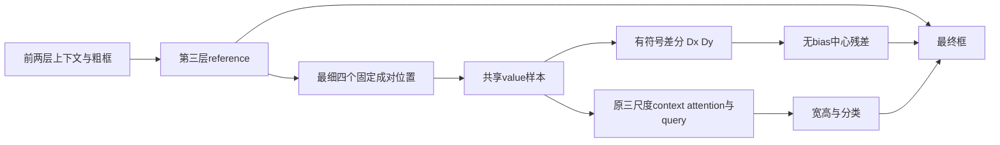

# 局部细节与上下文：一次限定的方法设计

最终只保留**H2：用成对有符号局部差分约束最后一层中心残差**，供下一次审查；H1“分类/定位空间分支解耦”因重复已有方法停止。H2有明确的任务依赖约束和最小CPU原型，但**不声称差分算子原创、已改善检测、或已建立论文贡献**。本轮GPU预算消耗为0，不延长固定P或其支持诊断。

## 1. 设计约束及尚未确认的问题

固定P质量FAIL、成本PASS，方案到此结束。32图终点诊断中，P的214个匹配普通小目标query跨层触发，共574个层实例；触发子集三层目标内有效条件占比平均变化约−1.0466/−1.3973/−1.3853个支持比例百分点。然而P绝对框内占比高于B0与其AP75-small下降并存。因此，几何扩张、框内支持和检测质量不能互相替代；不能把“上下文干扰”“梯度冲突”或“采样塌缩”写成已确认的训练根因。[冻结诊断结果](https://github.com/Six-of-Sheep/SparseRTDETR_VisDrone/blob/45cac46b3b3b329d3c3ee12bcc0293c23e24ccc1/docs/research/r18_target_support/RESULTS.md)

新的可检验问题是：**上下文已经形成一个粗框后，最后的中心微调是否应直接依赖可辨别方向的局部特征差分，而不是继续允许共同语义分量独立产生平移？** 这是设计假设，不是对旧模型根因的断言。这里的“局部细节”仅指stride8已有特征中的局部差异，不代表新增原图分辨率或恢复了已丢失纹理。

## 2. H1：分类/定位使用不同空间特征——停止

公式可以写成

\[
q_c'=\operatorname{CA}_c(q_c,F),\quad q_b'=\operatorname{CA}_b(q_b,F),
\quad p=\operatorname{Cls}(q_c'),\quad b=\operatorname{Box}(q_b').
\]

作用位置是decoder cross-attention及预测头。训练需要图像、标准GT及匹配监督；推理只需图像和query，不需要GT。最简单控制是当前共享query/attention的B0，或普通独立分类/回归头。

SD-DETR的Fig.3及Eq.(3)已经分开分类/定位query、cross-attention和FFN，并共享self-attention。H1仅把这个方向移至R18/小目标，**没有可确认的实质方法差异**，所以停止，不做原型或GPU候选。不能把P未通过改写成任务解耦必然有效。[SD-DETR正文](https://openaccess.thecvf.com/content/ICCV2023/papers/Zhang_Decoupled_DETR_Spatially_Disentangling_Localization_and_Classification_for_Improved_End-to-End_ICCV_2023_paper.pdf)

## 3. H2：最后一层中心残差的差分通路——唯一保留

### 3.1 精确计算

前两层保留原R18 decoder，得到当前reference \(r=(c_x,c_y,w,h)\) 和上下文query。仅修改第三层最细level的4个采样点；其余两个level各4点沿用原生offset。三层、8 heads、Q300、每头12点、单整图输入保持。最细点的位置是

\[
s_{x+}=c+(w/4,0),\quad s_{x-}=c-(w/4,0),
\quad s_{y+}=c+(0,h/4),\quad s_{y-}=c-(0,h/4).
\]

坐标为归一化画布坐标，w/h来自当前reference，**没有cell下限、GT判据、阈值扫描、裁边或新分辨率分支**。四点在每个head的空间位置相同，各head使用自身32个value通道。固定1/4是本次一次性几何选择，不是经结果调出的系数；不承诺它优于学习offset。

对第三层value projection之后、attention权重汇总之前的最细value场 \(V_0\)，使用与共同协议相同的双线性/zeros/align_corners=False采样，得到 \(v_{x+},v_{x-},v_{y+},v_{y-}\in\mathbb R^{256}\)。这些样本同时用于原context attention求和，未来集成不得额外再采一次。定义已有成对差分及均值：

\[
D_x=(v_{x+}-v_{x-})/2,\quad D_y=(v_{y+}-v_{y-})/2,
\qquad S_x=(v_{x+}+v_{x-})/2,\quad S_y=(v_{y+}+v_{y-})/2.
\]

context query \(q_3\) 仍由原12点联合softmax及原decoder操作得到；它服务分类和宽高。最终中心只取一个**无bias**线性差分读出：

\[
\Delta\ell_c=W_D[D_x;D_y],\quad W_D\in\mathbb R^{2\times512},
\]
\[
\hat c=\sigma\{\iota(c)+\Delta\ell_c\},\qquad
\hat{(w,h)}=\sigma\{\iota(w,h)+f_{wh}(q_3)\},\qquad
\hat p=f_{cls}(q_3).
\]

\(\iota\)复用原`inverse_sigmoid`表达式与eps=1e−5。零差分意味着**学习的中心logit残差为零**；c在原clamp范围内时中心保持，靠近0/1的边界仍有原inverse_sigmoid数值截断，不能声称数学上处处零位移。W_D零初始化，保留原“初始残差为零”的原则。

### 3.2 训练、推理及实际detach路径

训练使用原图像和GT框/类别，通过原Hungarian、VFL/L1/GIoU及DN监督学习；**没有边缘伪标签、框内支持损失、额外teacher或新损失代理**。允许训练GT，但不把GT注入采样位置或推理分支。前两层和所有未改参数沿用共同协议初始化；W_D为新增零初始化读出。第三层普通与DN query都按同一公式处理，不为DN另设新规则。完整训练集成尚未实现，不能称生产就绪。

推理只需图像、第三层已有reference、投影value及context query；不需要GT、目标大小真值、支持比例或二值推理门控。宽高/分类的计算头保持上下文路径，但最细几何变化会改变q3，**不保证其数值不变**。

采样reference使用原`ref_points_detach`，不新增穿过前一框的采样坐标梯度。最终box输出仍须保留原训练aux路径中未detach前一reference的角色：forward取值相同，梯度角色不同。原生`inter_ref_bbox`/aux输出的差异不能被单一detach变量覆盖。CPU叶层把“采样reference.detach()”和“输出reference”分开验证；这不是已验收的完整detector接线。

### 3.3 与最近直接先例的差异

|先例与已读范围|已有计算/作用|H2的具体差异及不能声称的内容|
|---|---|---|
|[SD-DETR](https://openaccess.thecvf.com/content/ICCV2023/papers/Zhang_Decoupled_DETR_Spatially_Disentangling_Localization_and_Classification_for_Improved_End-to-End_ICCV_2023_paper.pdf)，PDF3–4页，§3.1–3.2/Fig.3/Eq.3|分类/定位分开query、CA和FFN。|H2不是再建两个decoder分支；只限制最后中心残差的输入，保留粗框和宽高/类别上下文。不能声称任务解耦原创。|
|[CDC](https://openaccess.thecvf.com/content_CVPR_2020/papers/Yu_Searching_Central_Difference_Convolutional_Networks_for_Face_Anti-Spoofing_CVPR_2020_paper.pdf)，PDF3–4页，§3.1/Eq.2–4|聚合邻点减中心，并可与普通卷积混合。|差分、抵消共有分量和纹理/语义组合都已有先例。H2检验的是中心logit残差是否应排除直接共同上下文通路，而非提出新梯度算子。|
|[PiDiNet](https://openaccess.thecvf.com/content/ICCV2021/papers/Su_Pixel_Difference_Networks_for_Efficient_Edge_Detection_ICCV_2021_paper.pdf)，PDF3–4页，§3/Eq.2–3|一般像素对差分加权；可折叠成普通卷积权重。|H2读出就是这种既有操作在box-relative四点上的特例；有限对称位置或换成R18本身都不是贡献。保留的假设是末层中心残差的结构约束及其受控检验。|
|[PiDiViT](https://openaccess.thecvf.com/content/ICCV2025/papers/Zhou_When_Pixel_Difference_Patterns_Meet_ViT_PiDiViT_for_Few-Shot_Object_ICCV_2025_paper.pdf)，PDF3–5页，§3.1–3.3/Eq.1–7|用PDC与普通卷积分支按注意力融合，配合多尺度ROI特征进行检测。|它已将差分/上下文融合用于检测。H2不把融合后的共同特征交给全部box回归，而要求最后中心残差无直接共同分量；没有已核到与之相同的中心零差分约束。此范围不证明全领域无人做过。|
|[SABL](https://www.ecva.net/papers/eccv_2020/papers_ECCV/papers/123490392.pdf)，PDF4–5页，Fig.2/§3.1–3.2|聚合ROI轴向特征，为四边做bucket分类及精回归。|H2仍用中心/宽高表示，不做四边bucket、边界GT标签或rescoring。不能声称首次用方向信息做精定位。|

五份原文及SHA见[REFERENCES.json](REFERENCES.json)。审查限定于这些最近直接先例及已有PR17范围；原作者代码未复现，不移植COCO/FAS数值，不把未检出当作原创性证明。如果后续发现相同的末层差分中心约束，应停止H2的独立方法候选身份，不用追加P诊断维持方向。

### 3.4 最简单常规控制及可表达性

最近常规控制U使用**完全相同的四点位置、样本、W_D、context路径和监督**，只允许原中心头直接相加：

\[
\Delta\ell_c^{U}=W_D[D_x;D_y]+f_c(q_3),\qquad
\Delta\ell_c^{H2}=W_D[D_x;D_y].
\]

U相当于普通局部PDC残差加原上下文box头，是已有做法的常规组合，**不是第二个创新候选或PiDiViT完整复现**。D与U的差异是明确删除直接上下文中心项，而非改名称、加一个模块或只改损失。

固定样本时，令W_D=[W_x,W_y]，H2等于四点普通线性读出，权重依次为 \((W_x/2,-W_x/2,W_y/2,-W_y/2)\)。D/S一起还是四点信息的可逆变换，不产生额外信息。U令f_c=0可表达H2，所以H2是更受限的函数类；它的依据只能是这种限制的归纳偏置可能有用，**不是更强的表达能力**。坐标、函数可表达性和训练轨迹分别判断，CPU等价不推出训练轨迹或检测收益相等。

## 4. CPU原型及反例

最小叶层为[src/sparse_rtdetr/research/local_detail_center.py](../../../src/sparse_rtdetr/research/local_detail_center.py)，运行入口`python -B tools/local_detail_cpu.py --check-only`。只用构造投影value图，不加载R18、checkpoint、真实图像/标注，没有optimizer或训练循环。参考框坐标与图例都人为构造，不是模型观测。

本次实际检查及构造反例见[cpu/CPU_REPORT.json](cpu/CPU_REPORT.json)、[CPU_CASES.json](cpu/CPU_CASES.json)、[完整16项检查](cpu/CPU_TESTS.txt)；[CPU_SOURCE.json](cpu/CPU_SOURCE.json)记录检查时实际源码字节，不是GPU认证。

16项检查通过、零skip，torch2.4.1+cpu、CUDA未初始化。覆盖四点坐标/非方形、无cell下限、原gather插值、D/S可逆、内区共有常量抵消、交换成对采样的符号反转、折叠普通线性权重、零差分约束、原inverse_sigmoid、采样detach、特征/输出aux局部梯度、零初始化读出梯度、多batch/通道与state读回。仅做合成局部梯度检查，没有参数更新。

必须保留的反例是：

- **平坦局部特征、粗框中心错误：**差分为0，H2无法靠最后中心残差纠正，即使GT不在粗框中心。U可以使用上下文中心项；这正是可能否定H2的情形。
- **只有背景坡度、没有对象：**差分仍非零，可产生错误中心修正。非零细节不是目标或正确方向的证据。
- **图像边界零填充：**常值有效特征也会因两端有效支持不对称产生差分，共模抵消只在采样支持完整的内区成立。
- **极小reference/模糊特征：**四点可能落在同一插值邻域，差分可很弱/为0；没有任何实际跨度或新增细节保证。

构造Gaussian偏移曲线只展示有符号响应：读出权重手设，没有拟合，不能当作AP、定位精度或真实鲁棒性收益。正式实验效应均UNKNOWN。

## 5. 能否否定H2及下一步

完整可否定三臂计划、预算和停止规则见[GPU_PROPOSAL.md](GPU_PROPOSAL.md)。本次最终状态是**保留H2作为一个待审假设，H1停止**，不启动GPU、不把CPU通过当机制成立，不恢复固定P/支持诊断。

如果H2不优于同采样/差分的U，则不能把普通PDC适配的收益算成“中心通路约束”的贡献；若比U好却不能通过相对新同轮N基线的高IoU及保护/成本目标，则结束这套固定H2。即使全部通过也只是单seed development初筛，后续跨seed/独立公开数据与论文判断另行决定。
